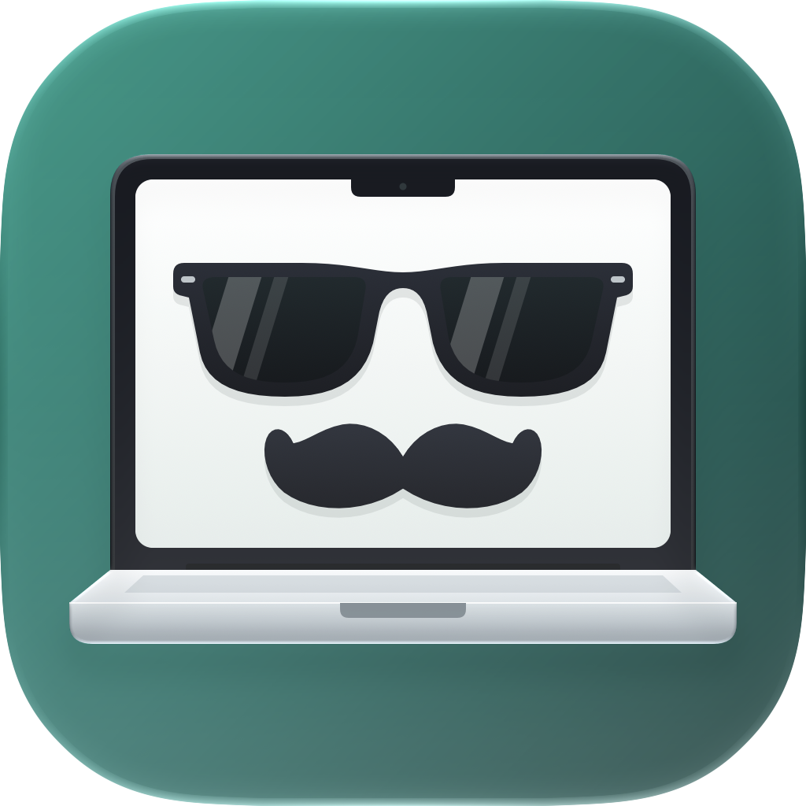

  

<h1 align="center">LookBusy</h1>

  
  <video src="https://github.com/user-attachments/assets/bc9da3be-e851-4083-bc2e-06b477e4294b" width="400" controls></video>

  Look busy. With a flick of your MacBook lid.

  LookBusy is a macOS menu bar utility that brings your chosen
  running app to the foreground when you quickly move your
  MacBook’s lid.

  <a href="https://github.com/ironnata/LookBusy-releases/releases/latest"><b>⬇️ Download the latest version</b></a>
    
  
  

---

## How it works

1. **Pick a cover app** in the Cover App tab. Choose the one you'd grab in an emergency: a code editor, a spreadsheet, whatever looks like real work.
2. **Keep it running.** Minimized or hidden with ⌘H is fine.
3. **Caught slacking?** Flick your lid. Ta-da, it pops to the front.

## The menu bar icon tells you how ready you are

| Icon state | Meaning |
|---|---|
| Mustache MacBook, solid | **Ready.** LookBusy can cover for you any time. |
| Red badge | **Not ready.** Click it to grant the permissions LookBusy needs. |
| Faded | **Paused.** Hinge trigger and shortcuts are off. |

## Settings

- **Sensitivity**: choose how easily a flick triggers.
- **Fine-tuning**: set hinge movement and cooldown between triggers.
- **Startup**: launch at login.
- **Your Mac**: check whether your MacBook is supported.

## Install

1. Download the latest `.dmg` from [Releases](https://github.com/ironnata/LookBusy-releases/releases/latest).
2. Open it and drag **LookBusy** to Applications.

LookBusy checks for updates on its own. You can also check manually: **LookBusy > Settings > General > Updates**.

**Requirements:** macOS 15.6 or later, and a MacBook with a lid angle sensor. Not sure about yours? Install LookBusy and look under **LookBusy > Settings > General > Your Mac**.

## FAQ

**Nothing happens when I flick the hinge.**
Check that the icon says Ready, then raise the sensitivity in General.

**It triggers on its own.**
Lower the sensitivity or increase the hinge movement.

**Does it work in clamshell mode (lid closed)?**
It's a just-for-fun app, so it only works through the hinge. It does work with external displays. Got ideas? Send feedback!

## Feedback

Annoyed by something? Missing a feature? Tell me anytime: **LookBusy > Settings > Help > Send email**.

---

© 2026 Jongmo You. LookBusy uses [Sparkle](https://sparkle-project.org) (MIT License) for updates.
